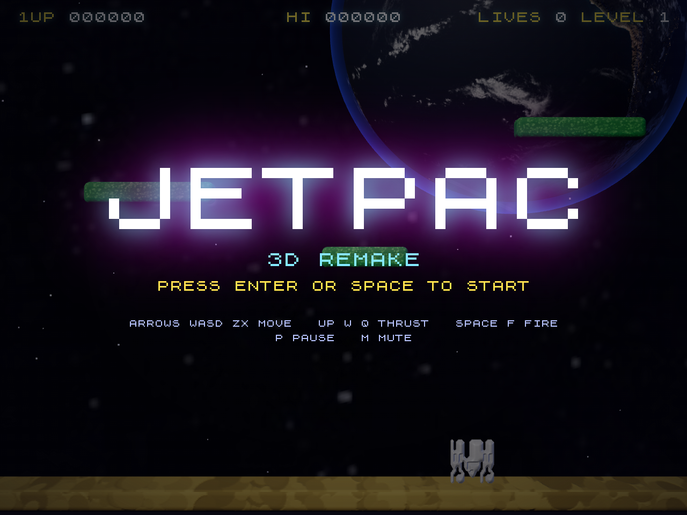
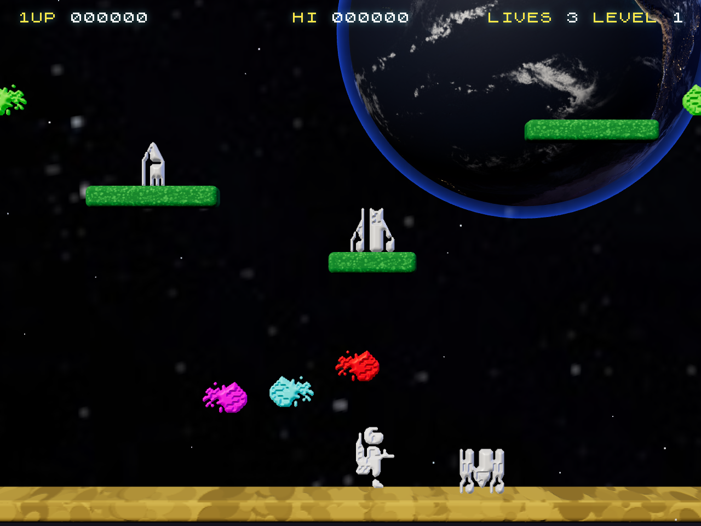
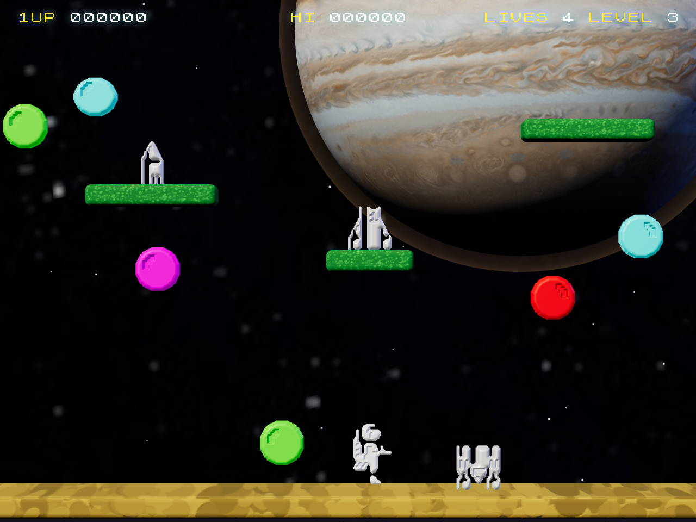
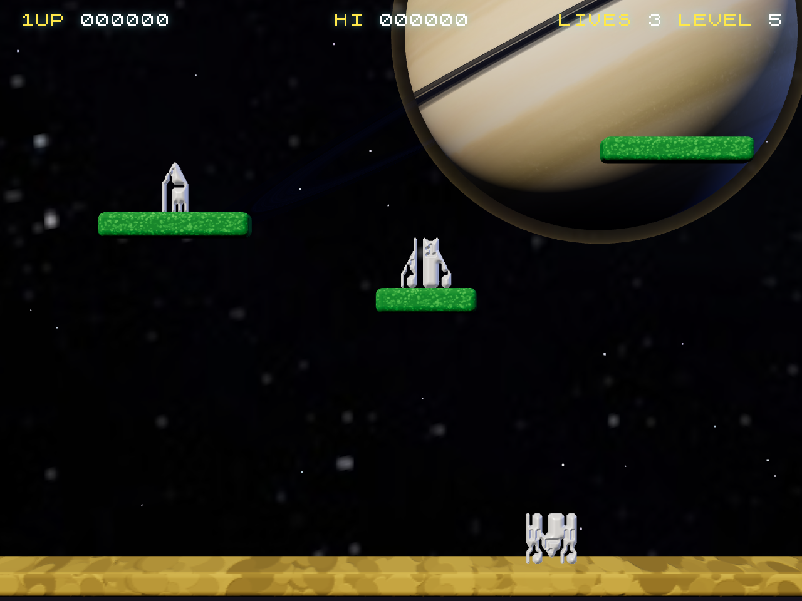
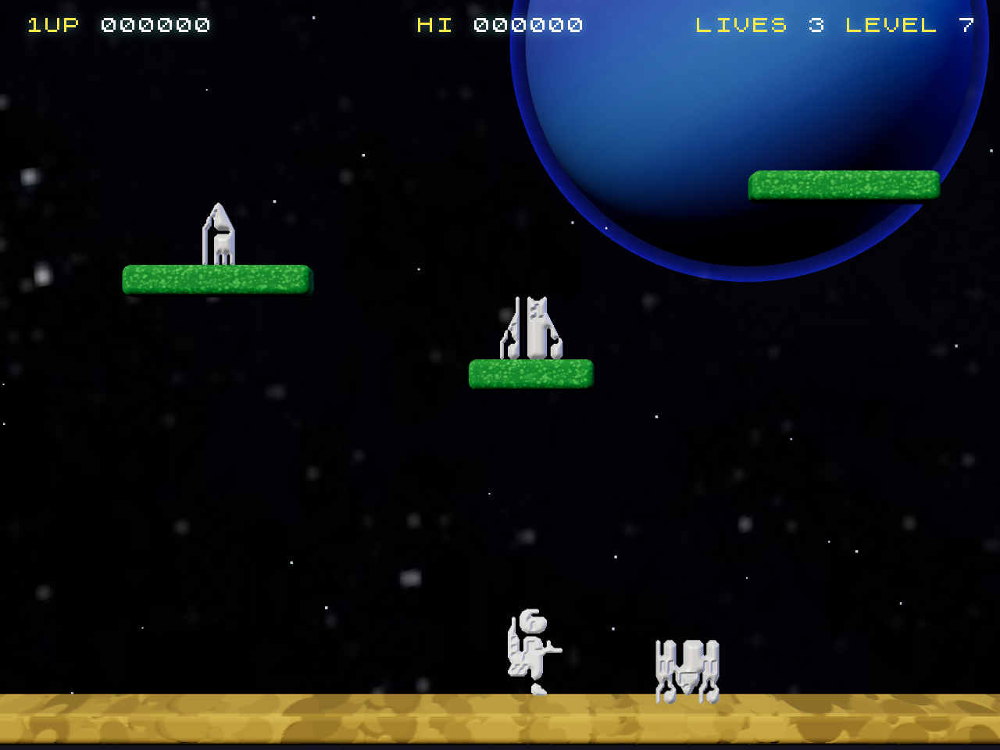

# JETPAC 3D - single page version

> **Test project.** This game exists only for testing purposes. It is an experiment in using an
> AI agent to port old code (here, the annotated Z80 disassembly of the 1983 ZX Spectrum game
> JETPAC) to other languages and platforms (here, JavaScript and three.js in the browser). It is
> an unofficial fan project and is not intended as a product.

`index.html` contains the whole game (logic, rendering, audio, HUD, sprite data, CSS) in one file.
three.js is loaded from the jsDelivr CDN through the import map at the top of the file, and the
planet textures are loaded from `textures/`, so keep that folder next to `index.html`.

## Screenshots

## Play locally

Browsers block ES modules and textures from `file://`, so serve the folder:

    cd standalone
    python -m http.server 8000     # then open http://localhost:8000

## Controls

- Move: arrows, A D, Z X
- Thrust: Up, W, Q
- Fire: Space, F
- P pause, M mute

## Rebuild

`index.html` is generated from the TypeScript sources in `../src`:

    npm run build:single

## Copyright

JETPAC Copyright, ULTIMATE PLAY THE GAME. Copyright & Trade Name, 1983 Ashby Computers & Graphics Ltd.
All rights reserved Worldwide.

3D version by Peter Valencic. Disassembly by Michael R. Cook
(<https://github.com/mrcook/jetpac-disassembly>).
